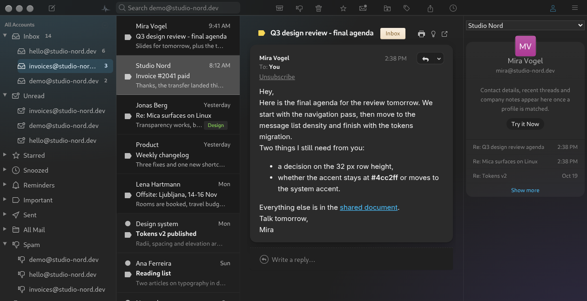

# FluentBird Dark for Mailspring

A Windows 11 Fluent / Mica-inspired dark theme for [Mailspring](https://getmailspring.com),
built on the visual language of [Deathbyteacup/fluentbird](https://github.com/Deathbyteacup/fluentbird).



Only the parts that survive a version bump are touched: no JavaScript, no build step, no patched
application files. Two LESS files, palette variables, and rules for the surfaces Mailspring draws
itself.

## What it changes

- **Layered dark surfaces** in Fluent tones: chrome `#1d2123`, navigation `#252525`, list `#1b1b1b`,
  message cards `#2b2b2b`.
- **Mica canvas** — two soft accent blooms behind the workspace, visible through the translucent
  navigation pane and the reading pane instead of a flat grey block.
- **Messages as cards** — 14 px radius, no borders, two-layer shadow; collapsed messages sit one
  step lower (`#262626`).
- **Reading pane typography** — 19 px bold subject, 600-weight sender, muted timestamps,
  14.5 px / 1.62 body. The translation banner becomes a soft accent strip with capsule buttons
  instead of a hard blue box.
- **Fluent nav rows** — 32 px rows on a 9 px radius, soft hover fill, muted uppercase section
  headings, and a selected row carried by an accent bar plus a light accent wash.
- **Quiet counters** — sidebar counts are plain secondary text (tabular figures), pushed to the
  right edge instead of trailing the label.
- **Muted mail labels** — programmatic label colors move from the chip fill to the label text, so
  they stop glowing on a dark background.
- **Visible icons** — the black PNG mail-state icons (attachment, star, important) are inverted;
  window buttons are no longer washed out.
- **Email frame safe** — `styles/email-frame.less` is injected into every message iframe: it aligns
  `color-scheme` and clears the frame background, which prevents the black block Chromium paints
  behind text when the email declares a dark scheme.

## Install

Clone into Mailspring's package directory, using the theme name as the folder name:

```sh
git clone https://github.com/omertahaoztop/mailspring-fluentbird.git \
  ~/.config/Mailspring/packages/fluentbird-dark
```

Then pick **FluentBird Dark** in *Preferences → Appearance* and restart Mailspring. Without the UI:

```json
// ~/.config/Mailspring/config.json, under core
"theme": "fluentbird-dark"
```

On macOS use `~/Library/Application Support/Mailspring/packages`, on Windows `%APPDATA%\Mailspring\packages`.

## Development

Edit `styles/ui-variables.less`, then switch to another theme and back (Preferences → Appearance),
or restart Mailspring; LESS is recompiled from disk on every theme switch.

Two quirks are worth knowing before editing:

- A theme file is compiled **before** the component files (every component starts with
  `@import 'ui-variables'`). Where the base theme sets a property with the same specificity, the base
  wins — either raise specificity (`.item.selected.selected`) or use `!important`. Both are marked
  in the file.
- Do not add `styles/index.less`. Mailspring would then load only that file and ignore
  `styles/email-frame.less`.

`--system-accent` is used when the platform provides it; otherwise the theme falls back to
Fluent blue `#4cc2ff`.

## Known limits

- The window chrome (title bar, Linux window buttons) is PNG-based, so the icon set cannot be
  replaced from CSS.
- Real Mica blur is not available: the Electron window is opaque, so the theme approximates it with
  translucent surfaces and accent blooms.
- Dark only. A light variant would be a second package with the same rules and inverted palette.
- The menu bar on Wayland is drawn by Chromium and ignores both theme and GTK CSS.

## Credits

Design direction borrowed from, none of the CSS copied:

- [Deathbyteacup/fluentbird](https://github.com/Deathbyteacup/fluentbird) — the original Fluent/Mica
  Thunderbird theme this one is named after.
- [mahype/fluentbird-dark](https://github.com/mahype/fluentbird-dark) — Fluent surface tonalities.
- [hugues1277/mailspring-ios-26-theme](https://github.com/hugues1277/mailspring-ios-26-theme) —
  Mailspring-specific approach, including the email iframe stylesheet.
- [AlexandreAgrn/mailspring-theme-brume](https://github.com/AlexandreAgrn/mailspring-theme-brume) —
  concentric radii, card-based reading pane, calm banners.
- [stupalov/thunderbird-tangaroa](https://github.com/stupalov/thunderbird-tangaroa),
  [bakatamas/thunderbird-clean-themes](https://github.com/bakatamas/thunderbird-clean-themes),
  [christefano/postbird-for-macos](https://github.com/christefano/postbird-for-macos),
  [tcana1/thunderbird-modern-them](https://github.com/tcana1/thunderbird-modern-them),
  [sruf79/halo-spaces](https://github.com/sruf79/halo-spaces) — density and iconography references.

## License

GPL-3.0-only — see [LICENSE](LICENSE). Copyright (C) 2026 Ömer Taha Öztop.
